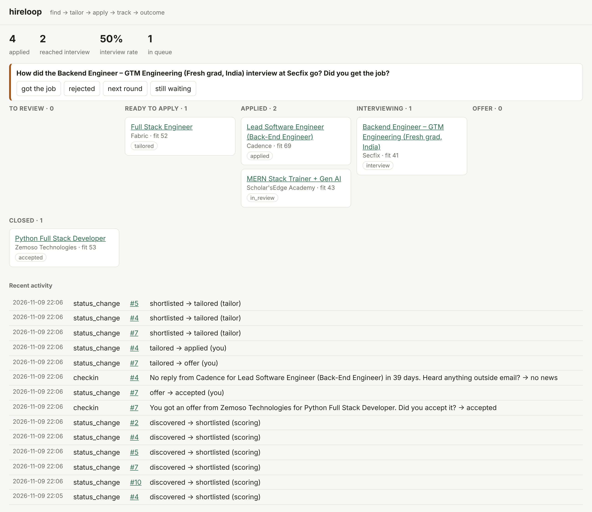

# hireloop

Find jobs → tailor an ATS-friendly resume per job (without making things up) → apply →
track replies from your inbox → ask you what happened → learn your real funnel.



Built for one person's job search first; every table already has a `user_id` so it can
become multi-user later.

## What already existed, and what this adds

| Project | Good at | Gap hireloop fills |
|---|---|---|
| [JobSpy](https://github.com/speedyapply/JobSpy) (MIT) | Scraping LinkedIn, Indeed, Glassdoor, Google, Naukri, Bayt… | Used directly as the discovery engine |
| [AIHawk](https://github.com/feder-cr/Jobs_Applier_AI_Agent_AIHawk) (MIT), [ApplyPilot](https://github.com/Pickle-Pixel/ApplyPilot) (AGPL) | Auto-filling and submitting forms | Tailoring is "ask the LLM not to lie". No inbox tracking or outcome loop |
| [career-ops](https://github.com/santifer/career-ops) (MIT) | Careful fit evaluation, human presses Submit | Runs inside an AI CLI, with no email tracking |
| [Resume-Matcher](https://github.com/srbhr/Resume-Matcher) (Apache-2.0) | ATS keyword matching | Resume only: no search, applying or tracking |
| [JobSync](https://github.com/Gsync/jobsync) (MIT), ApplyTrail, CareerSync | Trackers, some with Gmail | No discovery, tailoring or applying |

hireloop's own ideas:

1. **No-fabrication check enforced in code, not just in the prompt.** The LLM returns a
   *plan* that points to bullet IDs in your master resume. Code builds the resume and drops
   any reference to bullets, skills, roles or projects that don't exist. A reworded bullet
   that adds a new number ("2M" → "5M") or a new technology falls back to your original
   wording. Cover letters get flagged for unsupported claims.
2. **The whole loop in one place:** search → score → tailor → apply → inbox → check-ins → funnel stats.
3. **Two-stage email classifier.** Regex rules handle the templated ATS emails for free,
   and the LLM handles the rest. Status only moves forward, so an old "we received your
   application" email can't undo an "interview".
4. **"Did you get the job?" check-ins**, raised after an offer, about a week after an
   interview, or after 3 weeks of silence. Your answer updates the status. Accepting an
   offer pauses applying.
5. **One form filler that reads field labels**, instead of hard-coded selectors per site.
   It never answers EEO or diversity questions. Answers written by the AI are flagged for review.
6. **Works without an API key.** Keyword scoring and keyword-based tailoring still run;
   adding Claude makes them smarter.

## Deliberate limits

- **Review mode is the default.** The browser fills the form and you click Submit. `auto`
  mode only submits on Greenhouse, Lever and Ashby forms, and only when no answer was
  written by the AI and nothing required is empty.
- **LinkedIn, Indeed, Naukri and Glassdoor "easy apply" are not automated.** Their terms
  forbid bots and they ban accounts. hireloop still finds those jobs and tailors for
  them, opens the posting, and tracks the application once you mark it applied.
- **CAPTCHAs are never bypassed.**
- A daily cap (default 15). Sending fewer, better-targeted applications gets a higher response rate.

## Setup

```bash
git clone <this repo> && cd hireloop
python -m venv .venv && source .venv/bin/activate
pip install -e '.[discover,apply,dev]'
pip install --no-deps python-jobspy      # it pins an old numpy; runtime works fine
playwright install chromium               # for the apply step
hireloop init                             # creates config.yaml + resume.yaml
export ANTHROPIC_API_KEY=...              # optional but recommended
hireloop import-resume ~/my_cv.pdf --force   # or hand-edit resume.yaml
```

Edit `config.yaml` to set your profile, search terms, locations and IMAP login.
For Gmail, turn on 2-step verification and create an
[App Password](https://myaccount.google.com/apppasswords), then:
`export HIRELOOP_IMAP_PASSWORD=...`. Mail is opened read-only and is never marked as read.

## Daily use

```bash
hireloop run              # discover → score → tailor top 5 → sync email
hireloop list --status tailored
hireloop show 12          # fit reasons, missing keywords, timeline
hireloop apply --top 3    # opens browser, fills forms; you review + submit
hireloop sync-email       # pull replies, update statuses
hireloop checkin          # answer "did you get it?" questions
hireloop status           # funnel + response/interview rates
hireloop dashboard        # http://127.0.0.1:8765
hireloop mark 12 applied  # anything you did by hand
hireloop add <url> --company X --title Y   # a job you found yourself
```

Each tailored job gets `output/<id>-<company>-<title>/` containing the `.docx` resume,
`cover_letter.txt`, and `report.txt` (keyword match before → after, gaps, and what the check blocked).

## Layout

```
hireloop/
  discover.py   JobSpy search, filters, dedupe, fit scoring (keywords + Claude)
  ats.py        ATS detection from URL, keyword extraction and match score
  resume.py     master resume model, ATS-friendly DOCX renderer
  tailor.py     Claude tailoring plan + no-fabrication check
  importer.py   PDF/DOCX resume → resume.yaml
  apply/        label-driven form filler + Playwright runner
  inbox.py      IMAP sync, email classifier, matching email → application
  followup.py   check-ins (the outcome loop)
  db.py         SQLite, status rules
  web.py        FastAPI dashboard
```

Tests: `pytest` (set `HIRELOOP_CHROMIUM=/path/to/chromium` if Playwright's bundled browser isn't installed).

## Roadmap to "for everyone"

- Gmail/Outlook OAuth instead of app passwords; push notifications for check-ins
- Hosted multi-user mode (`user_id` is already in every table) with per-user encrypted credentials
- Use outcome data to improve scoring: which kinds of jobs actually reply to you
- Site adapters for Workday and SmartRecruiters multi-page forms
